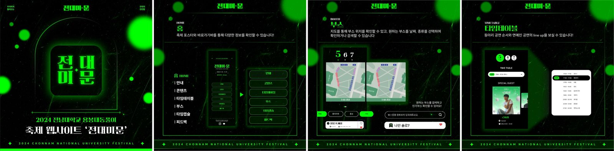
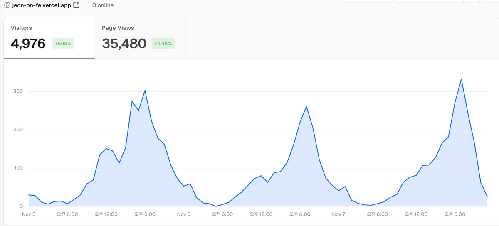
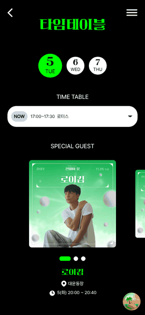
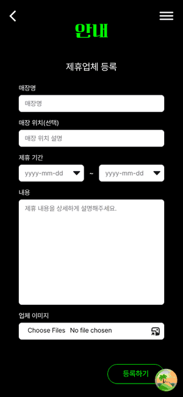
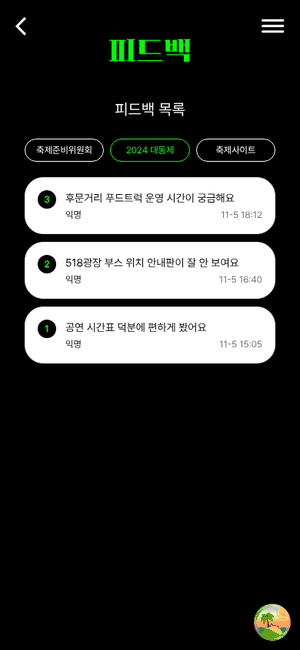
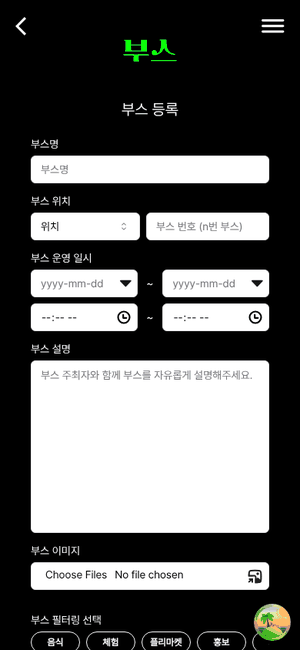

<div align="center">


# 전대미문 (JeonOn)

**전남대 축제 방문객이 공연 시간표·부스·제휴업체 정보를 한곳에서 확인하는 2024 대동제 공식 웹사이트**

[📂 원본 레포](https://github.com/9oormthonUNIV-JNU/JeonOn-FE)




</div>

## 📌 About
> 구름톤 유니브(goormthon UNIV) 3기 전남대 팀 프로젝트 · 전남대 축제준비위원회 협업 실서비스 · 2024

- **문제**: 축제 정보(공연 시간, 부스 위치, 제휴업체)가 포스터·SNS에 흩어져 있어 현장 방문객이 한눈에 확인하기 어려웠습니다.
- **해결**: 지도·제휴업체·콘텐츠·타임테이블·부스·타임캡슐·피드백을 한 사이트에 모았습니다. 현장 모바일 사용자와 PC로 정보를 등록하는 축준위를 하나의 코드로 지원하기 위해 **PWA**로 배포하고, 팸플릿·팔찌 QR로 바로 접속하게 했습니다.
- **성과**: 2024 전남대 대동제(11.05\~11.07) 3일간 실제 운영 — **방문자 4,976명 · 페이지뷰 35,480회** (Vercel Analytics)

<details>
<summary>📈 운영 기간 방문자 추이 (매일 저녁 공연 시간대 피크)</summary>
<br>

</details>

## 🙋‍♀️ My Role
> 기획·초기 개발이 끝난 시점(10월 초)에 FE로 중간 합류해, 남아 있던 타임테이블과 관리자 페이지를 맡았습니다.

- **타임테이블** — 날짜 탭 + 날짜별 공연 필터링, 첫 진입 시 오늘 날짜 자동 선택, 진행 중 공연을 분 단위로 갱신하는 **NOW 표시**, Swiper coverflow **스페셜 게스트 캐러셀**
- **관리자 지도·제휴업체 등록** — 이미지와 JSON을 함께 보내기 위해 `multipart/form-data`에 JSON은 `Blob(application/json)` 파트로 구성 (BE `@RequestPart` 스펙에 맞춤)
- **관리자 부스 등록** — 운영 기간·시간·카테고리·시간대 입력, 날짜·시간 역전 등 **클라이언트 유효성 검사**
- **관리자 피드백 확인** — 유형별 탭 목록, 아코디언 상세 조회, 첨부 이미지 확대 모달
- **공용 `CustomDatePicker`** — react-datepicker를 다크 테마로 커스텀해 제휴업체·부스 등록에서 재사용
- 주 역할 외 — 팀 QA에서 QA 의견 24건 작성(타 파트 개선점·기존 컴포넌트 재사용 제안), 타임캡슐(팀원 구현) 최종 QA 수정(이메일 검증, API 성공 시에만 완료 모달)

## ✨ Features
| 타임테이블 | 제휴업체 등록 (관리자) | 피드백 확인 (관리자) | 부스 등록 (관리자) |
| :---: | :---: | :---: | :---: |
|  |  |  |  |
| 공연 사이엔 첫 공연을 회색 NOW로, 20:00이 되면 현재 공연으로 자동 전환 | 기간 선택·이미지 최대 3장 미리보기 후 등록 | 유형별 목록 → 상세 펼침 → 이미지 확대 | 위치·운영 일시·카테고리·시간대 선택 후 등록 |

> 축제 종료 후 서버가 종료되어, 화면은 이 레포 코드를 로컬에서 실행해 녹화했습니다. 관리자 화면의 API 응답(피드백 목록·등록 성공)은 **목업 데이터**입니다.

## 🛠 Tech Stack
| 분류 | 기술 |
| :--- | :--- |
| **Frontend** (담당) |          |
| **Frontend** (팀) |   |
| **Backend** (팀) |      |
| **Infra · Tools** |      |

## 🔥 Troubleshooting
<details>
<summary><b>축제 하루 전 이미지 로딩 지연 — 스페셜 게스트 이미지 79.4MB → 0.27MB(−99.7%)</b></summary>

- **문제**: 축준위에게 받은 아티스트 이미지 10장(2251px PNG, 장당 약 8MB, 합계 79.4MB)을 그대로 넣어, 최종 QA에서 타임테이블 이미지 로딩 지연이 확인됐습니다. 사용자 대부분은 축제 현장의 모바일 데이터 환경이었습니다.
- **원인**: 모바일에서 캐러셀 슬라이드가 표시되는 크기는 약 340px인데 원본은 2251px로, 표시 크기 대비 해상도와 용량이 과도했습니다.
- **해결**: 먼저 WebP로 포맷만 바꿨지만 37.6MB로 여전히 컸고, 해상도가 핵심 원인임을 확인했습니다. 고해상도 화면 2배수를 고려해 **563px로 리사이즈 후 JPG로 압축**하고, 캐러셀 박스를 1:1로 고정해 레이아웃을 유지했습니다. (지연 로딩·CDN 리사이징은 축제 전날 구조 변경 부담으로 보류)
- **결과**: 10장 합계 79.4MB → 0.27MB, 장당 약 8MB → 21\~36KB. 로딩 지연 없이 축제 당일 운영했습니다. 외부 에셋은 **넣기 전에 표시 크기 기준으로 리사이즈**해야 하고, 포맷보다 해상도가 용량에 훨씬 큰 영향을 준다는 것을 배웠습니다.
</details>

<details>
<summary><b>관리자 등록 날짜가 하루 앞당겨 저장되던 버그 — <code>toISOString()</code>의 UTC 변환 보정</b></summary>

- **문제**: 축준위가 실제로 정보를 등록하기 직전 팀 QA에서, 달력으로 11월 5일을 골라도 서버에 11월 4일로 저장되는 문제를 발견했습니다. 부스 날짜 필터와 제휴 기간이 하루씩 어긋났습니다.
- **원인**: react-datepicker는 선택한 날을 **KST 자정**의 `Date`로 반환하는데, `toISOString()`은 UTC로 변환하므로 KST 00:00이 전날 15:00이 되어 날짜가 하루 앞당겨졌습니다.
- **해결**: 날짜 라이브러리 도입, 직접 문자열 조립, 오프셋 보정을 비교해 축제 전날 변경 범위가 가장 작은 **타임존 오프셋 보정**을 선택했고, 같은 로직을 쓰던 제휴업체·부스 등록 두 곳을 함께 수정했습니다.
  ```ts
  new Date(date.getTime() - date.getTimezoneOffset() * 60000).toISOString().split("T")[0]
  ```
- **결과**: 선택한 날짜 그대로 저장되고 부스 날짜 필터가 정상 동작했습니다. 날짜만 다루는 값은 로컬 기준으로 직렬화해야 한다는 것을 배웠습니다.
</details>

<details>
<summary><b>현재 공연(NOW) 실시간 표시 — 정각 동기화 타이머로 분이 바뀌는 순간 전환</b></summary>

- **문제**: 하루 9\~11개 공연이 20\~40분 단위로 바뀌고 공연 사이에 무대 준비 시간이 있어, 새로고침 없이 정확한 시각에 NOW가 바뀌어야 하고 공백 시간에도 빈 화면이 없어야 했습니다.
- **원인**: 1분 `setInterval`만 쓰면 진입 시점에 따라 최대 59초 늦게 전환되고, 1초 갱신은 불필요한 리렌더링이 생깁니다.
- **해결**: **다음 정각(00초)까지 `setTimeout` 후 1분 간격으로 갱신**하도록 구현했습니다. QA 의견을 반영해 진행 중 공연이 없으면 그날 첫 공연을 회색 NOW로 표시하고, 펼칠 수 있다는 것을 화살표 아이콘으로 안내했습니다.
- **결과**: 축제 3일간 현재 공연을 실시간으로 표시했습니다. 돌아보면 `setTimeout` 안에서 만든 `setInterval`이 cleanup과 연결되지 않은 점, 공백 시간에는 첫 공연보다 다음 공연을 보여주는 편이 낫다는 점이 개선할 부분입니다.
</details>

<details>
<summary><b>📂 Folder Structure · 🚀 Getting Started</b></summary>

```
src
├─ api            map.ts · afilliate.ts · feedbacks.ts · admin.ts · booth.ts
├─ components
│  ├─ ui          arcodion.tsx (타임테이블 NOW) · shadcn/ui 컴포넌트
│  └─ common      DatePicker/CustomDatePicker · Modal · Button
├─ constants      events.ts (공연 데이터·타입)
├─ pages
│  ├─ TimeTable.tsx
│  └─ AdminPage   RegisterMap · RegisterAffilate · RegisterBooth · ViewFeedback
└─ Router.tsx
```

```bash
npm install
npm run dev
```

- API 주소는 `VITE_CLIENT_URL` 환경 변수로 지정합니다. 축제 종료 후 서버가 종료되어 API 연동 기능은 동작하지 않습니다.
- 관리자 라우트는 운영 직전 보안 이슈로 막아 두어 `Router.tsx`에서 주석 처리되어 있습니다.
</details>
